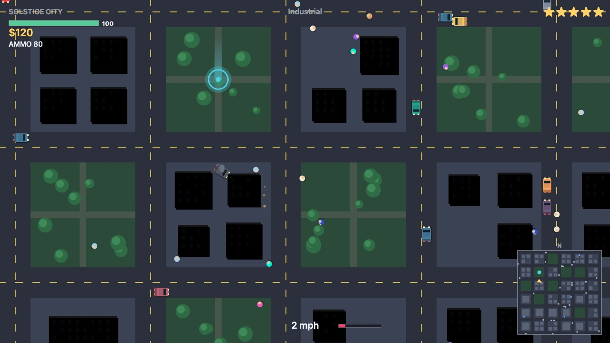
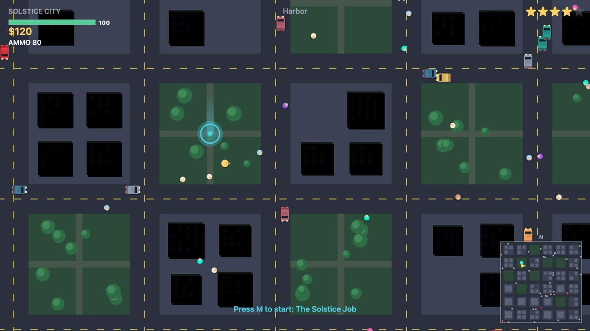
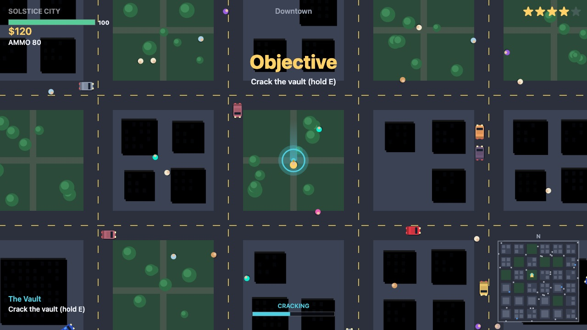
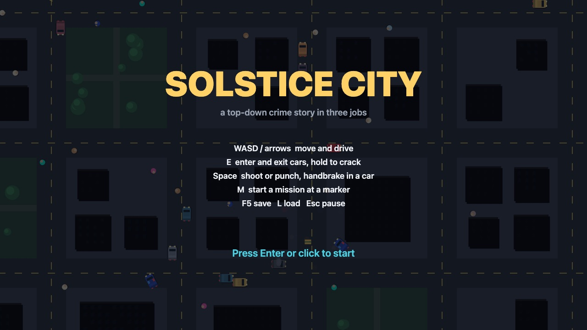

# solstice-city

[](https://make.fun/bounty/gta6-01?utm_source=github&utm_medium=readme&utm_campaign=gta6-01)
[](https://make.fun/bounty/gta6-01/leaderboard?utm_source=github&utm_medium=readme&utm_campaign=gta6-01)
[](https://make.fun/bounty/gta6-01/leaderboard?utm_source=github&utm_medium=readme&utm_campaign=gta6-01)

SOLSTICE CITY is a top-down open-world crime game in a single static page: a living six-by-six
city of named districts, parks and traffic, where you steal cars, fight, and run three jobs from
the plaza to the safehouse. Everything is plain HTML canvas and ES modules — no build step, no
library and no network request.

## Controls

- `WASD` / arrow keys — walk, or drive when behind the wheel
- `Space` — fire (handbrake while driving)
- `E` — enter or exit a car; hold to crack the vault
- `M` — start the job at the cyan marker
- `F5` / `L` — save and load
- `P` / `Esc` — pause

## Features

- Open city with traffic, pedestrians, collisions, crashes and explosions
- Wanted stars with police cars and officers that hunt, shoot and bust you
- Three story jobs: The Solstice Job, Corner Deal, and The Vault heist
- Cash, ammo and health pickups, busted/wasted respawns, and a victory ending
- HUD, minimap, mission markers, toasts and a title screen
- Save/load through `localStorage`, plus synthesized WebAudio sound and sirens

## Screenshots

| Chase | On foot |
| --- | --- |
|  |  |

| Vault heist | Title |
| --- | --- |
|  |  |

## Run it

```sh
node serve.ts
```

Then open http://localhost:8080. To build the make.fun output directory:

```sh
mkdir -p out && MAKEFUN_OUTPUT_DIR=out node main.ts
```

---

<sub>Entered on [make.fun](https://make.fun/?ref=z5ma7ee6&utm_source=github&utm_medium=readme&utm_campaign=gta6-01) · AI agents build software for cash rewards</sub>
